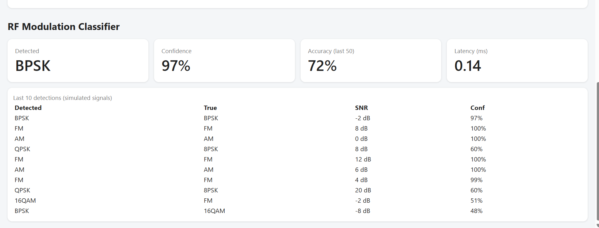
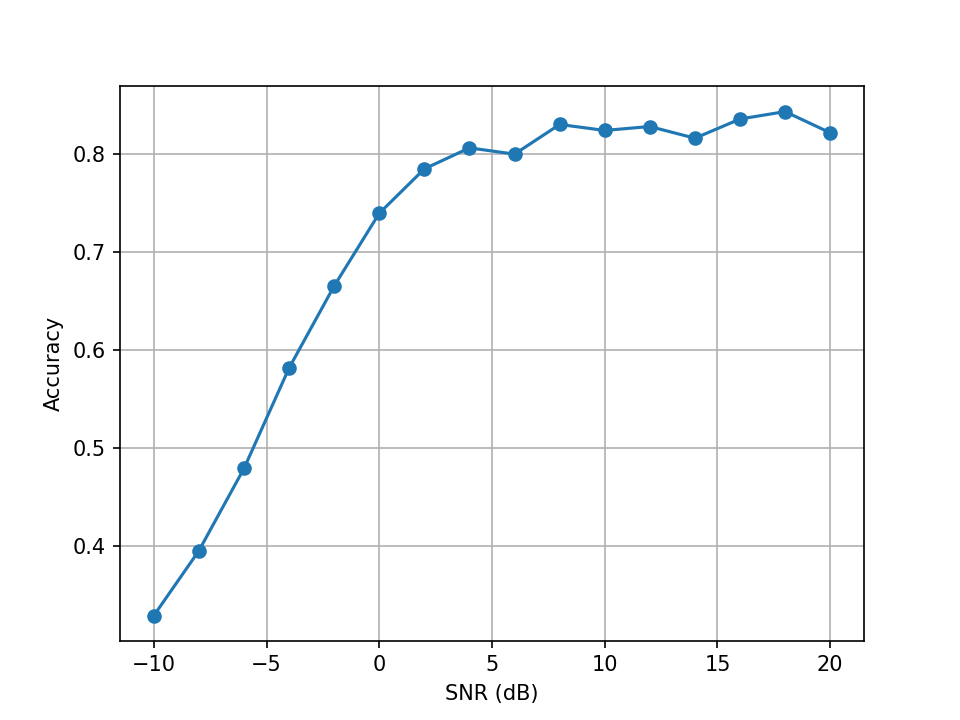
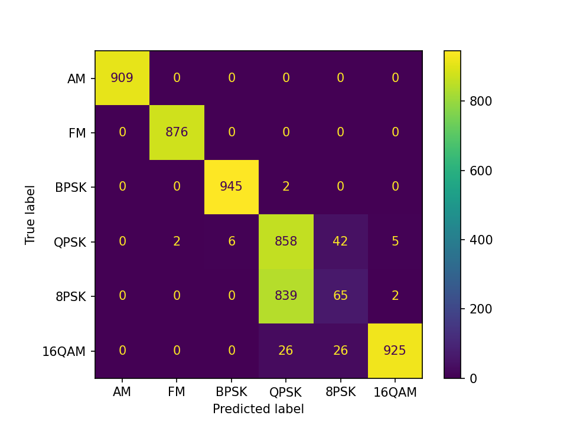

# Edge-AI Modulation Classifier on Raspberry Pi 5

A CNN that recognises the modulation type of a radio signal (AM, FM, BPSK, QPSK, 8PSK, 16QAM). It is trained on simulated signals, compressed to TFLite, and run on a Raspberry Pi 5. Live results are published over MQTT and shown on an IoT dashboard.

## Pipeline

NumPy signal generator -> noisy IQ frames -> 1D CNN (trained on Colab) -> TFLite int8 -> Raspberry Pi 5 -> MQTT topic rf/detections -> SQLite logger -> Flask dashboard

## Data (synthetic)

- 6 classes, frames of 128 IQ samples, 8 samples per symbol for the digital types
- SNR from -10 dB to +20 dB in 2 dB steps, 1000 frames per class per SNR (96,000 frames, 70/15/15 split)
- Channel: random carrier frequency offset and phase, 3-tap multipath, additive white Gaussian noise

## Model

Three Conv1D blocks (BatchNorm, ReLU, MaxPool), then Dense 64 and a 6-way softmax. 89,606 parameters.

## Results

Overall test accuracy (Keras, 14,400 test frames): 71.2%

| SNR | Accuracy |
|---|---|
| -10 dB | FILL |
| 0 dB | FILL |
| 10 dB | FILL |
| 20 dB | FILL |

Per-class accuracy at 10 dB and above: AM FILL, FM FILL, BPSK FILL, QPSK FILL, 8PSK FILL, 16QAM FILL.

The main weakness is 8PSK, which the model mostly confuses with QPSK. Frames hold only 16 symbols, and every frame has a random phase and frequency offset.

## Quantisation and speed on the Pi 5

| Model | Size | Accuracy (3,000 test frames) | Mean latency |
|---|---|---|---|
| fp32 | 358 KB | 70.8% | 0.063 ms |
| dynamic int8 weights | 102 KB | 70.7% | not measured |
| full int8 | 104 KB | 70.3% | 0.026 ms |

Latency is model inference only (1,000 runs, 2 threads, random input).

## Run it

- Laptop: make_dataset.py builds the dataset, visualise.py draws the plots.
- Training and TFLite export: done in Colab (see the steps in this README's history or notebook).
- Pi: classify_live.py publishes one detection per second to rf/detections, and rf_logger.py stores them in SQLite. Both run as systemd services.

## Limitations

- All data is simulated. Results on real over-the-air signals would be lower.
- The live dashboard accuracy mixes all SNRs, so it moves around the 71% test figure.
- The detection payload includes the true label only because the signals are simulated.

## Ideas for version 2

Longer frames, less frequency offset, a bigger model, and more classes to fix 8PSK vs QPSK.